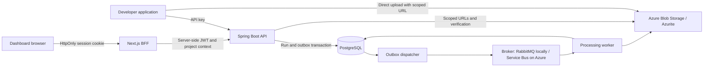

<p align="center">
  
</p>

# Sluice

[](https://github.com/sluice-hq/sluice/actions/workflows/ci.yml)
[](LICENSE)

Sluice is an API-first media-processing platform. Applications upload media directly to object storage, start an asynchronous run against an immutable pipeline version, and retrieve durable run and output data. The Next.js dashboard is the control plane for projects, API keys, processors, pipelines, and operational inspection.

The repository provides a verified local product flow and a locally validated Terraform foundation for Azure. No hosted deployment has been applied or verified yet.

## Capabilities

- Project-scoped JWT and API-key access, one-time API-key reveal, hash-only key storage, revocation, and an HttpOnly dashboard session.
- Direct Azure Blob Storage or Azurite uploads with completion verification and short-lived download URLs.
- Versioned processor releases; revision-checked pipeline drafts; immutable published versions and aliases; contract validation before publication and execution.
- Durable asynchronous runs with PostgreSQL-backed outbox delivery, RabbitMQ locally and Azure Service Bus in production, idle-safe retry recovery, step facts, output provenance, Server-Sent Events, and signed terminal webhooks.
- Deterministic local media-governance decisions with persisted allow/review/block evidence, plus an Azure AI Content Safety adapter awaiting live Azure provisioning and verification.
- Email verification and password recovery with hashed, expiring, single-use link tokens, an encrypted PostgreSQL email outbox, bounded retries, local email capture and an Azure Communication Services Email adapter.
- Processor market, searchable guided and JSON pipeline authoring with descriptive starter flows and enabled-release safeguards, first-run checklist, API Quick Start, pipeline test console, and asset/run/governance inspection.
- Local Prometheus and Grafana monitoring, plus backend, integration, API-smoke, and Playwright browser verification.

## Architecture



The API commits each run and its queue event together in PostgreSQL. The outbox dispatcher publishes pending work to the broker, and workers process media and persist results. The dashboard's backend-for-frontend keeps the JWT server-side, so browser JavaScript receives only the HttpOnly session cookie.

| Responsibility | Local implementation | Azure target architecture |
|---|---|---|
| API and worker | Combined source runtime or separate production-like containers | Separate Azure Container Apps |
| Dashboard | Next.js | Azure Container App |
| Durable data | PostgreSQL 16 | Azure Database for PostgreSQL Flexible Server |
| Media | Azurite | Private Azure Blob Storage |
| Queue | RabbitMQ | Azure Service Bus |
| Media governance | Deterministic local provider | Azure AI Content Safety |
| Authentication email | Bounded in-memory capture | Azure Communication Services Email |
| Observability | Actuator, Prometheus, Grafana | Azure Monitor and Application Insights |

RabbitMQ remains the local broker. The production profile selects Azure Service Bus with Managed Identity, explicit peek-lock settlement, duplicate detection keyed by durable outbox event, dead-letter handling, and queue-driven worker scaling. Neither adapter changes the durable run state machine.

## Processors

Built-in processor releases cover validation, image metadata, checksums, resize, metadata stripping, WebP conversion, and content-safety governance. Processor definitions declare versioned input/output contracts and configuration schemas; pipeline steps pin an exact release.

| Processor | Current behavior |
|---|---|
| `mime-validation` | Sniffs content with Java's built-in detector, then applies exact MIME or explicit wildcard rules. |
| `metadata` | Rejects unreadable images and records dimensions and file size as run-step facts. |
| `checksum` | Streams any resource into a SHA-256 digest recorded as a run-step fact. |
| `resize` | Performs bounded, aspect-preserving image resize. |
| `strip-metadata` | Rewrites supported JPEG, PNG, and WebP images without EXIF, GPS, camera, comment, or color-profile data. |
| `webp` | Produces deterministic WebP output with bounded quality settings and startup codec verification. |
| `governance.content-safety` | Persists `ALLOW`, `REVIEW`, or `BLOCK` decisions from the configured provider. |

Local governance uses a deterministic provider so tests can exercise all decision paths without network access. It is a test double, not AI moderation or a real harmful-content classifier. The Azure adapter rejects incomplete category evidence rather than allowing the image. It accepts static JPEG, PNG and WebP images up to 4,000,000 bytes with each dimension between 50 and 2048 pixels, using the conservative REST contract limit. An opt-in live smoke test exists but has not been run against Azure.

## Quick start

Prerequisites:

- Java 17
- Node.js 24 LTS with npm
- Docker Desktop with the Docker engine running

Start the full local stack from the repository root:

```powershell
.\scripts\start-local.ps1
```

The script starts PostgreSQL, RabbitMQ, Azurite, Prometheus, Grafana, the API, and the dashboard. It waits for the API and dashboard, then prints their local addresses. Open [http://localhost:3000/signup](http://localhost:3000/signup) to create an account and project.

Run the deterministic API-first demonstration after the stack is ready:

```powershell
.\scripts\demo-local.ps1
```

It creates a local demo account and API key, publishes a listing-image pipeline, transfers an original synthetic 1400 by 900 PNG to Azurite, and verifies the processed WebP, metadata removal, application references, policy result and a real signed terminal webhook. The generated input is deliberately unoptimized; its byte savings are demonstration evidence rather than a production benchmark. The receiver uses host port 8787, which must be reachable from the API container.

The [marketplace reference client](examples/marketplace/README.md) exposes a typed `uploadAndRun` helper for applications. It uses the public API, keeps storage credentials separate from API credentials, and supports the same integration against a configured hosted deployment.

Stop local processes and services while retaining Compose volumes:

```powershell
.\scripts\stop-local.ps1
```

For interactive development, start the infrastructure from the repository root:

```powershell
docker compose up -d
```

Then run the API and dashboard in separate terminals:

```powershell
cd backend
.\gradlew.bat bootRun
```

```powershell
cd frontend
npm ci
npm run dev
```

To exercise the release images locally, build and start the separate API, worker, and dashboard containers:

```powershell
docker compose --profile app up -d --build --wait frontend worker
```

This path uses local-only credentials and the same PostgreSQL, RabbitMQ, and Azurite dependencies. The API container owns HTTP traffic, outbox dispatch, webhook delivery, dependency probes, database migrations, processor-catalog synchronization, and durable retry/stuck-run recovery. The worker disables Flyway, has no HTTP server, owns queue consumption and pipeline execution, and performs only a read-only audit that every published processor has a matching implementation. Keeping recovery on the controlled-demo API allows an Azure worker at zero replicas to be woken by a newly published retry. Stop the containerized application with `docker compose --profile app down`.

## API workflow

Use the dashboard to create a project and reveal an API key, then use the API from an application. Machine requests authenticate with:

```http
X-API-Key: sl_live_<one-time-secret>
```

The preferred upload-and-run sequence is:

1. Create a pending asset with `POST /api/v1/uploads`, an `Idempotency-Key`, and `filename`, `contentType`, and `size`. Applications may also provide `externalSubjectId` and `externalReference` as stable correlation identifiers.
2. PUT the bytes to the returned write-only SAS URL.
3. Finalize the asset with `POST /api/v1/uploads/{assetId}/complete` and an `Idempotency-Key`.
4. Start a run with `POST /api/v1/runs`, specifying a published pipeline slug, alias or version, and `inputAssetId`.
5. Poll `GET /api/v1/runs/{id}`, subscribe to `/api/v1/runs/{id}/events`, or receive a signed terminal webhook.

External references are optional opaque identifiers scoped to the authenticated Sluice project. They are returned on input and derived assets and support exact `GET /api/v1/assets?externalSubjectId=...&externalReference=...` filtering. They are not authentication claims: use stable internal IDs such as `user_123`, never usernames, email addresses, access tokens, or other personal or secret values.

Asset discovery is server-side and paginated. `GET /api/v1/assets` accepts a case-insensitive literal `filename` search, exact `status`, MIME-family `mediaType` such as `image`, inclusive `createdFrom`, exclusive `createdBefore`, and the exact external-reference filters above. Filters compose inside the authenticated project boundary. Results default to stable `createdAt DESC, id DESC` ordering; callers overriding the order can repeat `sort` to retain a unique tie-breaker, for example `sort=filename,asc&sort=id,asc`.

Governance discovery uses the canonical paginated run endpoint. `GET /api/v1/runs?governanceOnly=true` returns only runs with persisted governance decisions and composes with exact `decision`, exact pipeline `slug`, inclusive `from`, and exclusive `to` filters. When a pipeline contains more than one governance step, `decision` means the result from the final governance step in durable pipeline order. The dashboard preserves those filters and the current page in the URL, and results use stable `createdAt DESC, id DESC` ordering so older decisions remain reachable.

Before authoring a new pipeline, a project manager must enable the exact processor releases it will use. The dashboard uses `GET /api/v1/projects/{projectId}/processor-releases`; enable or disable a release with `PUT` or `DELETE` on `.../{slug}/versions/{version}`. Enablement is project-scoped, and disabling a release does not invalidate already-published pipeline versions.

Example PowerShell request sequence:

```powershell
$api = "http://localhost:8080/api/v1"
$headers = @{ "X-API-Key" = $env:SLUICE_API_KEY }
$body = @{ filename = "photo.png"; contentType = "image/png"; size = (Get-Item .\photo.png).Length; externalSubjectId = "user_123"; externalReference = "avatar_2026_08" } | ConvertTo-Json
$upload = Invoke-RestMethod -Method Post -Uri "$api/uploads" -Headers ($headers + @{ "Idempotency-Key" = "upload-create-001" }) -ContentType "application/json" -Body $body

Invoke-WebRequest -Method Put -Uri $upload.uploadUrl -Headers @{ "x-ms-blob-type" = "BlockBlob"; "Content-Type" = "image/png" } -InFile .\photo.png
Invoke-RestMethod -Method Post -Uri "$api/uploads/$($upload.assetId)/complete" -Headers ($headers + @{ "Idempotency-Key" = "upload-complete-001" })

$runBody = @{ pipeline = "product-images"; alias = "stable"; inputAssetId = $upload.assetId } | ConvertTo-Json
$run = Invoke-RestMethod -Method Post -Uri "$api/runs" -Headers ($headers + @{ "Idempotency-Key" = "run-create-001" }) -ContentType "application/json" -Body $runBody
Invoke-RestMethod -Method Get -Uri "$api/runs/$($run.id)" -Headers $headers
Invoke-RestMethod -Method Get -Uri "$api/assets?externalSubjectId=user_123&externalReference=avatar_2026_08" -Headers $headers
```

Authenticated API clients can request the generated OpenAPI contract at [`/api/v1/openapi.json`](http://localhost:8080/api/v1/openapi.json). The signed-in dashboard exposes the same contract through its authenticated proxy.

## Configuration

[`.env.example`](.env.example) is the safe reference for Sluice-specific environment settings. Copy only the values you need into a local process environment or deployment secret store; do not commit populated secrets. Local defaults in [`backend/src/main/resources/application.properties`](backend/src/main/resources/application.properties) match `docker-compose.yml`.

| Variable | Purpose | Local default or expectation |
|---|---|---|
| `API_BASE_URL` | API origin used by the Next.js BFF | `http://localhost:8080/api/v1` |
| `SLUICE_PUBLIC_API_BASE_URL` | Public API origin shown by Quick Start | `http://localhost:8080/api/v1` |
| `SLUICE_DASHBOARD_URL` | Canonical trusted dashboard origin used by public auth protection | `http://localhost:3000` |
| `SLUICE_SECURE_COOKIES` | Require HTTPS-only dashboard cookies | `false` only for local HTTP; omit in production |
| `SLUICE_STORAGE_PUBLIC_BASE_URL`, `SLUICE_STORAGE_INTERNAL_BASE_URL` | Optional dashboard mapping when browser and container Blob endpoints differ | Set only by the local Compose application profile |
| `SLUICE_RUNTIME_MODE` | Backend capability boundary: `all`, `api`, or `worker` | `all` for source development; images select `api` or `worker` |
| `SLUICE_MESSAGING_PROVIDER` | Queue adapter: `rabbit` or `servicebus` | `rabbit` locally; production defaults to `servicebus` |
| `AZURE_SERVICE_BUS_FULLY_QUALIFIED_NAMESPACE`, `AZURE_SERVICE_BUS_QUEUE_NAME` | Hosted queue address and entity | Injected by Terraform into API and worker |
| `AZURE_SERVICE_BUS_MAX_AUTO_LOCK_RENEW_DURATION` | Maximum automatic queue-message lock renewal as an ISO-8601 duration | `PT15M`, long enough for a bounded multi-step run |
| `AZURE_CLIENT_ID` | User-assigned Managed Identity used by the Azure SDK | Separate sender-only API and receiver-only worker identities |
| `SLUICE_DB_URL`, `SLUICE_DB_USERNAME`, `SLUICE_DB_PASSWORD` | PostgreSQL connection | Compose-compatible local defaults |
| `AZURE_STORAGE_CONNECTION_STRING` | Azure Blob Storage or Azurite connection | Local Azurite default in application config |
| `AZURE_STORAGE_CONTAINER_NAME` | Blob container | `assets` |
| `SLUICE_JWT_SECRET` | Dashboard/API JWT signing secret | Replace for any non-local environment |
| `SLUICE_CORS_ALLOWED_ORIGINS` | Allowed dashboard origin | `http://localhost:3000` |
| `SLUICE_GOVERNANCE_PROVIDER` | `local` deterministic provider or `azure` adapter | `local` |
| `AZURE_CONTENT_SAFETY_ENDPOINT`, `AZURE_CONTENT_SAFETY_API_KEY` | Azure provider execution credentials | Required by the worker only for `azure` governance; the API retains processor metadata without them |
| `SLUICE_MEDIA_*`, `SLUICE_IMAGE_*` | Upload and image-processing safety limits | See `.env.example` |

The backend release images select the strict `production` Spring profile by default. Azure must provide database, storage, JWT, CORS, and runtime-owned email or governance settings through the environment or secret references. The worker image disables Flyway so production migrations remain a controlled deployment/API-startup responsibility. Compose explicitly selects a local profile so its non-production credentials cannot be mistaken for hosted configuration.

## Testing

Run backend tests from `backend`:

```powershell
.\gradlew.bat test --console=plain
.\gradlew.bat externalIntegrationTest --console=plain
```

The default suite uses Testcontainers PostgreSQL. The external integration test uses disposable PostgreSQL, RabbitMQ, and Azurite containers to verify the end-to-end processing path.

Run frontend checks from `frontend`:

```powershell
npm run lint
npm run build
npx playwright install chromium
npm run test:e2e
```

Test the public API reference helper from the repository root:

```powershell
frontend/node_modules/.bin/tsc.cmd --project examples/marketplace/tsconfig.json
node --test examples/marketplace/client.test.ts
```

Azure provider checks are separate and opt-in. After configuring an approved Content Safety resource, set `SLUICE_RUN_LIVE_AZURE_TESTS=true` and run `./gradlew.bat liveAzureTest --console=plain` from `backend`. This contacts Azure and may consume credit; ordinary tests never run it.

With a verified email sender and an explicit `SLUICE_EMAIL_SMOKE_RECIPIENT`, `./gradlew.bat liveAzureEmailTest --console=plain` checks ACS Email submission under the same opt-in flag. Confirm inbox arrival and real account verification/recovery separately; a successful provider submission is not a delivery receipt.

The browser test requires the local application to be running. It covers authentication and session behavior, CSRF rejection, project switching and feedback, API keys, processor discovery and enablement, guided/JSON pipeline authoring, upload/run/output, asset and governance discovery, and responsive navigation. GitHub Actions runs backend (including the real dependency integration test) and frontend verification in parallel, then builds and inspects the three release images and runs the browser and API-smoke paths through the Compose `app` profile in one dependent product gate.

Before committing, check whitespace errors from the repository root:

```powershell
git diff --check
```

## Repository layout

```text
backend/                 Spring Boot API/worker, production Dockerfile, Flyway migrations, and tests
frontend/                Next.js dashboard/BFF, standalone Dockerfile, and browser tests
demo/                    Deterministic pipeline and media fixture for the local demo
examples/marketplace/    Typed API helper, synthetic listing fixture and verified webhook integration
monitoring/              Prometheus and Grafana provisioning
infra/terraform/         Azure foundation, safe examples, and credential-free plan tests
scripts/                 Local start, stop, and API-smoke scripts
docker-compose.yml       Local dependencies, monitoring, and optional release-image application profile
.env.example             Safe configuration reference
```

## Security boundaries

- Tenant data is project-scoped in the authentication context and application queries.
- The dashboard stores its JWT in an HttpOnly, SameSite cookie; the BFF forwards it server-side.
- Email verification and password recovery use expiring, single-use tokens with SHA-256 lookup hashes. Email retry payloads containing links are authenticated-encrypted separately. Password resets invalidate earlier dashboard JWTs through a credential-session version check.
- Authentication requests have generic recovery/verification responses, bounded per-client and per-subject controls, and redacted audit records. Recovery and resend requests use a durable inbox; link emails use an authenticated-encrypted PostgreSQL outbox with leased claims, bounded retries and expiry suppression. Local delivery captures email in memory; production uses Azure Communication Services Email. Provider acceptance is distinct from arrival in a recipient's inbox.
- Production signup defaults to an exact email allowlist; an empty allowlist disables new accounts. Public production registration is blocked until shared abuse controls and capacity quotas are implemented. Local source development remains open.
- Public-beta webhook registration also requires protection against DNS rebinding. Current validation checks resolved addresses, while the HTTP connection resolves the hostname separately; use trusted demo accounts until pinned resolution or an enforced outbound proxy/network policy closes that boundary.
- State-changing authenticated dashboard proxy requests require a matching `X-Sluice-CSRF` header and SameSite CSRF cookie. Public authentication proxies separately reject browser requests that do not originate from Sluice.
- API keys use 256 bits of randomness, are shown once, stored only as SHA-256 hashes, project-scoped, and revocable.
- Blob containers are private. Upload and download access uses short-lived SAS URLs.
- Pipeline contracts and media limits constrain supported content; arbitrary custom processor code, remote-URL processing, unrestricted graphs, quotas, request-cost enforcement, and custom marketplace submissions are not implemented V1 capabilities.
- Processor manifest time and memory values are budgets. Built-in processors share a worker process, image time checks are cooperative, and container memory limits do not provide per-processor isolation.

## Deployment status

Sluice has multi-stage, non-root release images for the Spring API, Spring worker, and standalone Next.js dashboard. The API and worker use explicit runtime modes, expose separate health checks, and can be exercised together through the optional Compose `app` profile. CI builds all three images and verifies their runtime users and bundled legal files.

The [Azure Terraform configuration](infra/terraform/README.md) defines ACR, Container Apps, private PostgreSQL, Blob Storage, Standard Service Bus, Key Vault and managed identities, monitoring, and budget notifications. Optional hosted-provider resources define Content Safety and Communication Services Email with an Azure-managed sender domain, diagnostics and scoped secret references. Enabling application revisions requires real hosted-provider configuration; production does not fall back to simulated delivery.

Manual GitHub Actions workflows prepare OIDC image publication and a reviewed Terraform plan/apply flow. Release images use digest references, plans remain in private encrypted Azure storage, and apply requires a protected environment. These workflows are inactive until the account, identities, environment protections, secrets and remote state are configured. The [deployment runbook](infra/terraform/DEPLOYMENT.md) describes setup, provider verification, rollback and teardown. The [shipping checklist](SHIP_CHECKLIST.md) separates completed code from live release gates.

No Azure resource has been created or deployed. Managed Identity, Key Vault, Service Bus scaling, actual moderation, recipient email delivery, telemetry and hosted rollback still require live verification. Public self-service protection remains separate work. This architecture is not permanently free, and budget notifications do not stop spending.

API and worker images bundle a checksum-pinned Application Insights Java agent. Their entrypoint attaches it only when `APPLICATIONINSIGHTS_CONNECTION_STRING` is configured; local images run without the exporter. Hosted roles distinguish API and worker telemetry. Container logs cover the dashboard; it does not have a browser or Node telemetry SDK. The Service Bus health signal reflects the last publish operation and remains unknown before the first operation, rather than claiming continuous connectivity.

## License

Sluice is licensed under the [Apache License 2.0](LICENSE).

Direct backend and frontend dependencies, their resolved versions, licenses,
upstream sources, and required attribution text are recorded in
[THIRD_PARTY_NOTICES.md](THIRD_PARTY_NOTICES.md). The notice is also embedded
in the backend executable JAR. The frontend production build includes the
notice and a generated bundle of the original license files shipped by every
direct runtime package.
